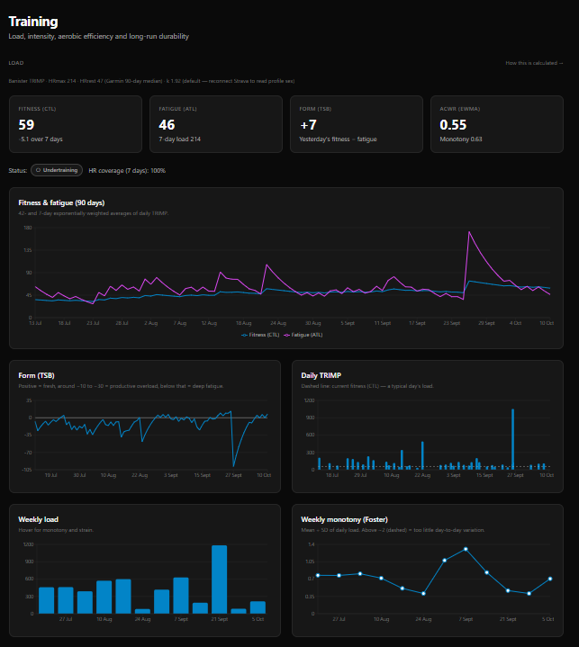
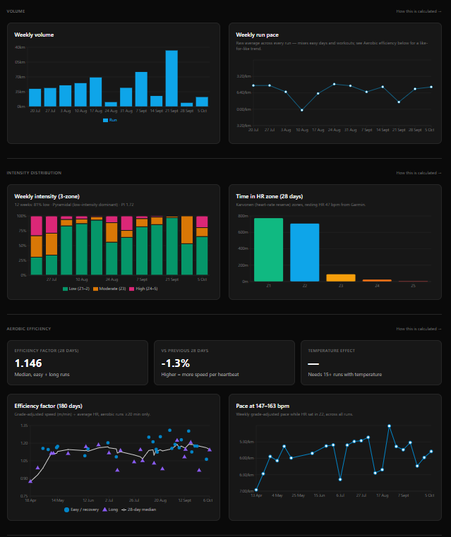
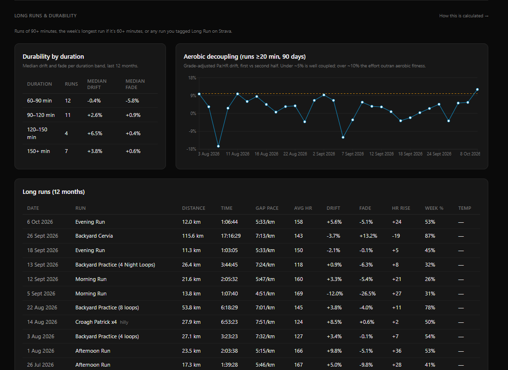
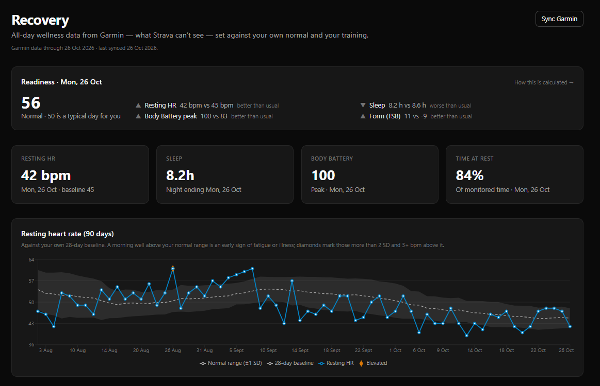
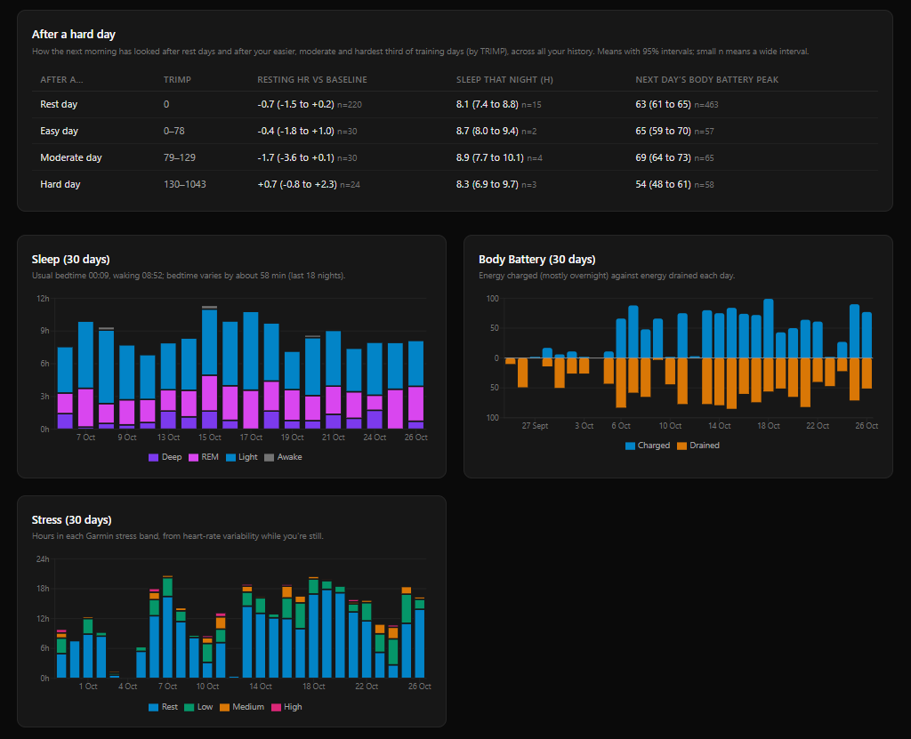
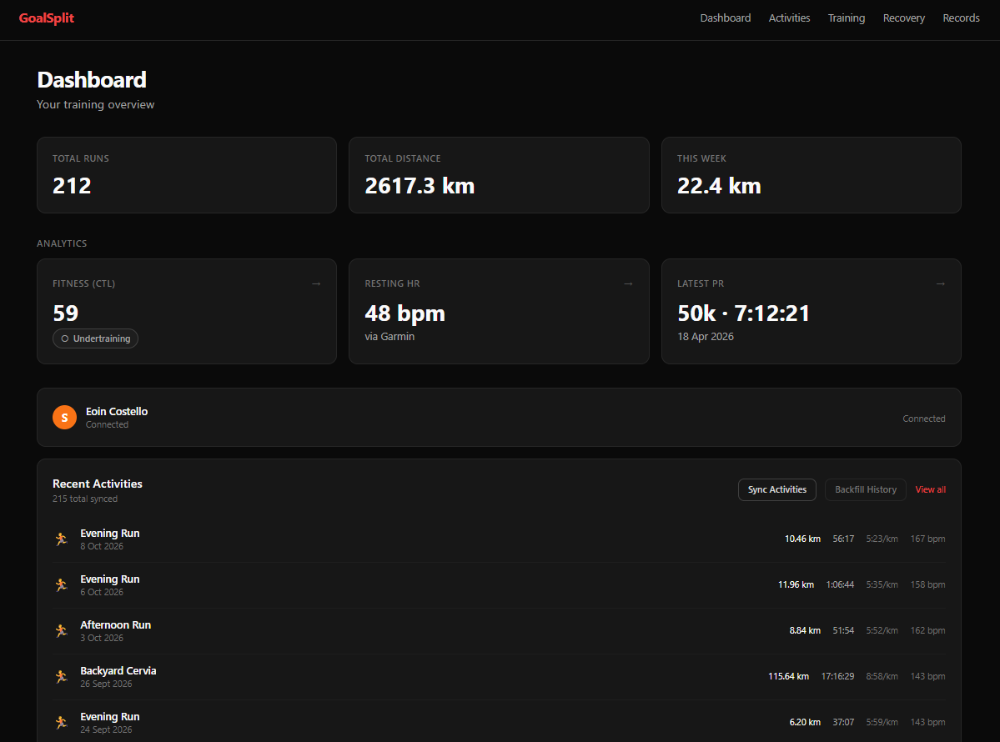

# GoalSplit

A training analytics project built on my own running data: two-plus years of Strava
activities with second-by-second heart rate, pace and elevation, plus daily Garmin
recovery data. It applies established endurance-science models to answer practical
questions:

- **How much am I training, and is it building or wearing me down?** (load, fitness, fatigue, form)
- **How hard is that training?** (intensity distribution, polarization)
- **Am I getting fitter?** (aerobic efficiency, pace at a fixed heart rate)
- **How well do I hold up over distance?** (long-run drift, fade, durability)

Every metric is defined, with its formula, assumptions and references, in
**[docs/METHODS.md](docs/METHODS.md)**.

## What it measures

| Area | Metrics | Model |
|---|---|---|
| Training load | TRIMP per session; fitness (CTL), fatigue (ATL) and form (TSB); acute:chronic workload ratio | Banister TRIMP and fitness–fatigue model; EWMA ACWR (Williams 2017) |
| Load pattern | Weekly monotony and strain | Foster (1998) |
| Intensity | Time in 5 HR zones; weekly low / moderate / high split; polarization index | Karvonen HR reserve; Seiler 3-zone; Treff (2019) |
| Aerobic fitness | Efficiency factor trend; grade-adjusted pace inside Z2 | Friel EF; Minetti (2002) GAP |
| Durability | Decoupling, pace fade and HR rise on long runs, binned by duration | Friel Pa:HR |
| Change detection | Training phases from weekly load; sustained shifts in efficiency and Z2 pace | Penalised mean-shift segmentation (optimal partitioning / PELT) |
| Recovery | Resting HR against a personal baseline, sleep stages and timing, Body Battery, stress; next-morning response to hard days; a transparent readiness score | Garmin Personal API |
| Records | Best efforts per distance, Strava-derived plus manual corrections | — |
| Race predictions | 5K–marathon times from recent road races, adjusted by the athlete's own record at each distance, with backtested error | Daniels VDOT (1979) |

## Screenshots

**Volume, intensity and aerobic efficiency:** weekly volume and pace, 3-zone intensity
split, time in HR zone, efficiency factor trend and pace at a fixed heart rate.

**Long runs and durability:** drift and fade by duration band, decoupling over time, and
a per-run breakdown.

**Recovery:** a transparent readiness score, and resting HR against a personal
28-day baseline, with elevated mornings flagged.

How the next morning responds to rest, easy, moderate and hard days, plus sleep
stages, Body Battery charge and drain, and stress.

**Dashboard:** headline stats, fitness and recent activities.

## Key terms

- **TRIMP (training impulse):** load of one session, from duration and heart rate,
  weighted exponentially so hard minutes count far more than easy ones.
- **CTL / ATL / TSB:** fitness (42-day weighted average of daily load), fatigue (7-day
  average) and form (fitness minus fatigue). Negative form means you're carrying fatigue.
- **ACWR:** recent load ÷ longer-term load. It shows how quickly training is ramping up.
- **Monotony / strain:** how little daily load varies across a week, and weekly load
  scaled by that. High strain with little variation is an overtraining warning sign.
- **HR zones:** five bands of heart-rate reserve (resting to max), from Z1 recovery to Z5 max.
- **Polarization index:** a single number for how much training sits at the easy and
  hard ends rather than the middle.
- **GAP (grade-adjusted pace):** pace converted to its flat-ground equivalent effort,
  so hilly and flat runs compare fairly.
- **Efficiency factor (EF):** grade-adjusted speed per heartbeat. Rising EF on easy runs = improving aerobic fitness.
- **Aerobic decoupling:** how much heart rate drifts up against pace from the first half of a run to the second.
- **Durability:** how drift and pace fade grow as runs get longer.
- **Change point:** the week a series shifts to a new level by more than its normal
  week-to-week noise, such as the start of a training phase or a step in fitness.

## Accounting for confounders

Pace and heart rate respond to more than fitness. The analysis controls for the main
confounders explicitly:

- **Terrain:** all pace and efficiency figures are grade-adjusted.
- **Session type:** each run is classified (easy, long, workout, recovery, race), using
  your own Strava tags first. Fitness trends only compare aerobic runs.
- **Heat:** a regression of efficiency on time and temperature estimates how much heat
  costs, and gives a temperature-adjusted trend line.
- **Data quality:** every view reports how much of the data actually had HR streams, so
  a gap in the data isn't mistaken for a change in fitness.

## Data pipeline

Activities sync from the Strava API and Garmin metrics from Garmin Connect. Raw payloads
are stored unchanged. Each activity's streams are reduced once to an HR histogram and
quarter splits, and all analysis runs on those summaries. The training log is also
exposed to Claude through an MCP server, for AI-assisted coaching conversations.

Built with Next.js, Express, PostgreSQL and TypeScript. To run it, deploy it or set up
syncing, see **[docs/SETUP.md](docs/SETUP.md)**.

## Research

Beyond the descriptive analytics, [research/](research/) holds statistical and
predictive questions answered in Python against the same data, each starting as a
written proposal:

1. [Training load vs performance](research/proposals/01-training-load-vs-performance.md):
   fitting an individual fitness–fatigue model and testing it out of sample.
   **[Findings](research/findings/01-training-load-vs-performance.md):** efficiency
   tracks the last two weeks of training (about 4–5% between a light and a heavy
   fortnight), but separate fitness and fatigue components aren't identifiable, and
   part of the link is reverse causation.
2. [Bottleneck identifier](research/proposals/02-bottleneck-identifier.md): which part
   of fitness most limits performance for a target event.

## Future additions

- **Training-block comparison:** compare blocks (e.g. a marathon build) on volume
  ramp, intensity distribution, long-run progression and efficiency change. Which kind
  of block led to the best race? The detected training phases are a natural starting
  point for defining blocks.
- **Recovery ↔ load modelling:** relate resting HR, sleep and stress (Garmin) to form
  and the previous days' load. For example, does a raised resting HR the morning after
  a big day predict worse efficiency or more decoupling? Includes lagged correlations
  against a personal baseline. (HRV isn't available on the current watch.)
- **Weather context:** historical temperature and humidity for each run's time and
  place, replacing the watch's skin-warmed temperature sensor in the heat adjustment.
- **Critical speed:** critical speed and D′ fitted to best efforts across durations,
  tracked over time.
