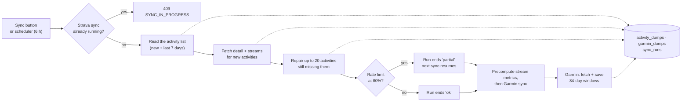

# Setup & operations

Running GoalSplit locally, deploying it, and keeping the data syncing. For what each
piece does and how they connect, see [Architecture](../README.md#architecture) in the
README. For logs, errors and health checks, see [OBSERVABILITY.md](OBSERVABILITY.md).

## Stack

Next.js 15 frontend (`apps/web`, port 3000) · Express 5 API (`apps/api`, port 3001) ·
PostgreSQL · shared TypeScript types (`packages/types`) · MCP server for Claude
(`apps/mcp-trainer`) · Python research code (`research/`). npm workspaces + Turborepo.

## Run locally

Requires:
- **Node.js 22** (20.19 or later works; production runs 22);
- **Docker Desktop**, for Postgres;
- **Python 3.13**, only for `research/`.

```sh
npm install
cp .env.example .env                  # Docker Compose: pick a POSTGRES_PASSWORD
cp apps/api/.env.example apps/api/.env # DATABASE_URL (below), Strava credentials, Garmin key
cp apps/web/.env.example apps/web/.env.local
docker compose up -d                  # Postgres on port 5433
npm run dev                           # web on :3000, API on :3001; migrations run on API start
```

`DATABASE_URL` in `apps/api/.env` uses the root `.env` values:
`postgresql://<POSTGRES_USER>:<POSTGRES_PASSWORD>@localhost:5433/<POSTGRES_DB>`.

Leave the security variables empty locally (`API_KEY`, `SESSION_SECRET`, …). The apps then
run open, with no sign-in screen.

Other commands, run from the repo root across every app: `npm run build`, `npm run test`,
`npm run type-check`, `npm run lint`. Python checks live in `research/` (see
[research/README.md](../research/README.md#development)).

## Strava

1. Create an app at [strava.com/settings/api](https://www.strava.com/settings/api), callback domain `localhost`.
2. Put `STRAVA_CLIENT_ID`, `STRAVA_CLIENT_SECRET` and
   `STRAVA_REDIRECT_URI=http://localhost:3000/api/auth/strava/callback` in `apps/api/.env`.
   The callback is the **web** app's route: it runs the sign-in flow (see [Security](#security)).
3. **Connect Strava** on the dashboard, then **Sync Activities**. In production, signing in
   *is* connecting Strava: **Sign in with Strava** on the login page does both.
4. Click **Backfill History** on the Activities page to fetch per-second streams for
   older activities. Streams power every HR- and pace-based analysis. The backfill stops
   at ~80 % of Strava's rate limit and resumes on the next click (see
   [Sync pipeline](#sync-pipeline)).

**After each run:** set the run type on Strava (*Race*, *Long Run* or *Workout*;
leave easy runs as default) and give workouts a descriptive name, then **Sync**.
Sync also re-reads the past 7 days, so edits made after syncing come through. Edits
to anything older need **Backfill History**.

Raw Strava payloads are kept in an append-only `activity_dumps` table, so nothing ever
needs re-fetching. Each activity's streams are summarised once into `activity_metrics`
(see [METHODS.md](METHODS.md#data-and-preprocessing)). The summary fills in lazily on
the first Training-page load after a backfill, and is rebuilt automatically when
`METRICS_VERSION` changes. Reconnecting Strava stores the athlete's profile sex, which
selects the TRIMP coefficients.

## Garmin

Garmin provides resting HR, sleep, stress and Body Battery (and HRV on watches that
record it). Its resting HR switches heart-rate zones to Karvonen. Data comes from
Garmin's official **Personal API** (free, launched October 2026), so it runs from the
API itself: no password, no home machine.

1. In Garmin Connect (web), open account settings → **Personal API Key** → **Create
   Key**, and choose an expiry (30 days to a year). The key is shown only once.
2. Set `GARMIN_API=<key>` in `apps/api/.env`, and in the API service's Railway variables.
3. **Sync** on the dashboard also refreshes Garmin. The first sync backfills everything
   since your first Strava activity, and later ones continue from the newest stored day.
   `POST /api/garmin/sync?days=N` re-syncs the last N days on demand.

When the key expires, sync reports "Garmin rejected the API key": create a new one
and update `GARMIN_API`. Resting HR from days the watch was barely worn is discarded
(see [METHODS.md](METHODS.md#heart-rate-zones)).

## Claude via MCP

`apps/mcp-trainer` exposes a `get_recent_training_data` tool, so Claude Desktop can pull
the recent training log. Build it with `npm run build --workspace=@goalsplit/mcp-trainer`, then add:

```json
{
  "mcpServers": {
    "goalsplit-trainer": {
      "command": "node",
      "args": ["C:\\ProjectFiles\\GoalSplit\\apps\\mcp-trainer\\dist\\index.js"],
      "env": { "GOALSPLIT_API_URL": "http://localhost:3001/api", "GOALSPLIT_API_KEY": "" }
    }
  }
}
```

`GOALSPLIT_API_KEY` is only needed when the API it points at has `API_KEY` set. The
repo's `.mcp.json` reads it from your environment rather than storing it.

## Environment variables

Every variable, by where it's set. "Prod" marks the ones a deployed service needs. The
API refuses to start in production without its three security variables, and a
production web build without `SESSION_SECRET` refuses every request. Locally, anything
not marked *needed locally* can stay empty. The `.env.example` files hold the same
list, with comments.

**API** (`apps/api/.env`, and the API service on Railway)

| Variable | Prod | Purpose |
|---|---|---|
| `DATABASE_URL` | ✓ | Postgres connection string. *Needed locally* |
| `STRAVA_CLIENT_ID`, `STRAVA_CLIENT_SECRET` | ✓ | Your Strava API app. *Needed locally* |
| `STRAVA_REDIRECT_URI` | ✓ | The **web** app's `/api/auth/strava/callback` URL. *Needed locally* |
| `API_KEY` | ✓ | Shared secret the web app and MCP server send as `x-api-key`. 32+ characters |
| `TOKEN_ENCRYPTION_KEY` | ✓ | 32 bytes (hex or base64): encrypts stored Strava tokens. Losing it means reconnecting Strava |
| `ALLOWED_STRAVA_ATHLETE_ID` | ✓ | The one Strava athlete allowed to sign in |
| `NODE_ENV` | ✓ | `production` on Railway (the Dockerfile sets it) |
| `GARMIN_API` | | Garmin Personal API key. Unset means no Garmin sync |
| `SENTRY_DSN` | | `goalsplit-api` DSN. Unset means Sentry is off |
| `SENTRY_TRACES_SAMPLE_RATE` | | Performance tracing, e.g. `0.1`. Default `0` |
| `SYNC_INTERVAL_MINUTES` | | Automatic sync interval. Default `360`; `0` turns it off |
| `LOG_LEVEL` | | `debug` / `info` (default) / `warn` / `error` |
| `SLOW_REQUEST_MS` | | Requests slower than this are logged as warnings. Default `2000` |
| `SHUTDOWN_GRACE_MS` | | How long in-flight requests get on shutdown. Default `8000` |
| `PORT` | | Default `3001` (Railway sets it) |

**Web** (`apps/web/.env.local`, and the web service on Railway)

| Variable | Prod | Purpose |
|---|---|---|
| `API_URL` | ✓ | The API's base URL, ending in `/api`, including `http(s)://`. Default `http://localhost:3001/api` |
| `API_KEY` | ✓ | Same value as the API's |
| `SESSION_SECRET` | ✓ | Signs session cookies; changing it signs you out |
| `SENTRY_DSN`, `NEXT_PUBLIC_SENTRY_DSN` | | `goalsplit-web` DSN, for the server and the browser. The browser one is baked in at build time |
| `SENTRY_AUTH_TOKEN`, `SENTRY_ORG`, `SENTRY_PROJECT` | | Build time only: source-map upload. The token is a secret |
| `SENTRY_TRACES_SAMPLE_RATE`, `NEXT_PUBLIC_SENTRY_TRACES_SAMPLE_RATE` | | Tracing, server and browser. Default `0` |

**Set by Railway automatically**, and read for logs, health and Sentry releases:
`RAILWAY_GIT_COMMIT_SHA` (the `version` on every log line), `RAILWAY_DEPLOYMENT_ID`,
`RAILWAY_ENVIRONMENT_NAME` and `RAILWAY_REPLICA_ID`. Locally they're absent and
`version` reads `dev`.

**Elsewhere:**

| File | Variables | For |
|---|---|---|
| `.env` (root) | `POSTGRES_DB`, `POSTGRES_USER`, `POSTGRES_PASSWORD` | Docker Compose's local and research databases |
| `.env.railway` | `DATABASE_URL` (Railway's *public* connection string) | `scripts/research-snapshot.ps1` only |
| `research/.env` | `DATABASE_URL` (the snapshot), `GOALSPLIT_API_URL`, `GOALSPLIT_API_KEY` | Research notebooks |
| MCP client config | `GOALSPLIT_API_URL`, `GOALSPLIT_API_KEY` | `apps/mcp-trainer` (see [Claude via MCP](#claude-via-mcp)) |

Generate secrets with `openssl rand -hex 32`.

## Security

GoalSplit is single-athlete. The pieces:

- **Sign-in:** Strava OAuth, run by the web app. A random `state` value in a
  short-lived cookie guards against login CSRF. The API only accepts the athlete in
  `ALLOWED_STRAVA_ATHLETE_ID` (locally, if unset: the first athlete to connect). A
  successful sign-in sets a signed, HttpOnly, `SameSite=Lax` session cookie that lasts
  30 days. **Sign out** clears it. Strava stays connected.
- **Web app as the only door:** `apps/web/src/middleware.ts` requires the session for
  every page and `/api/*` call. The browser never talks to the API directly. It calls
  the web app's same-origin `/api/*` proxy, which adds the API key server-side.
- **API:** every `/api` route requires `API_KEY` (`x-api-key` or `Authorization: Bearer`).
  Only the health checks (`/health`, `/health/live`, `/health/ready`) are open. The API
  sends no CORS headers, so browsers can't call it cross-origin at all.
- **Rate limits** (API, per 15 min): 600 requests overall, 10 syncs (Strava + Garmin),
  20 OAuth code exchanges.
- **Strava tokens** are encrypted at rest with AES-256-GCM (`TOKEN_ENCRYPTION_KEY`).
  Plaintext rows from before encryption are encrypted at startup. Concurrent refreshes
  share one Strava call. If Strava revokes access, sync says so: sign out and sign in again.
- **Fail closed:** with `NODE_ENV=production` the API won't start without `API_KEY`,
  `TOKEN_ENCRYPTION_KEY` and `ALLOWED_STRAVA_ATHLETE_ID`. A production web build
  without `SESSION_SECRET` refuses every request.

Locally, leaving those variables empty runs everything open, with no sign-in.

## Sync pipeline

Syncs run when you click **Sync**, and automatically every `SYNC_INTERVAL_MINUTES`
(default 360, i.e. every 6 hours; `0` turns it off). Each Strava sync is followed by
metric precomputation and a Garmin sync. The dashboard's **Data sync** panel shows the
latest run of each, with the reason if it failed or stopped early.



- **Strava, incremental:** fetches activities newer than the latest stored one, and
  re-reads the past 7 days to pick up edits. New activities get their detail and streams
  straight away. Each sync also *repairs* up to 20 activities still missing them, for
  example ones saved by a sync that hit the rate limit. Activities Strava has no streams
  for (manual entries) are flagged once and not asked about again.
- **Strava rate limits:** Strava meters an overall bucket and a stricter read bucket,
  each per 15 minutes and per day. Syncs read both from the response headers and stop at
  80 % of whichever is closest to its limit. A stopped sync reports `complete: false` and
  why, and the next one continues. If the last incremental sync didn't finish reading the
  activity list, the next one resumes from its cursor.
- **Garmin:** fetched and saved in windows of up to 84 days. The first sync (and the one
  after a `GARMIN_MAPPING_VERSION` bump) backfills full history. If it's cut off, the
  next sync resumes after the last saved window. After that, syncs start a few days
  before the newest stored day, so a stretch without syncing leaves no gap.
- **Failures:** every outbound call has a 30 s timeout. Network errors and 5xx get 2
  retries with backoff; 4xx never do. Only one sync per source runs at a time; a second
  request gets `409`. Every attempt is recorded in `sync_runs` (status `ok`, `partial`,
  `failed` or `interrupted`). Runs cut off by a restart are marked `interrupted` at startup.
- **Expired or revoked Strava token:** the token is flagged. The dashboard shows
  **Reconnect Strava**, and scheduled syncs pause until you do. Sign-in requires the
  `activity:read_all` permission, since syncs can't work without it.
- **Logs:** one line per request (request id, method, path, status, duration) and per sync
  (run id, counts, duration, rate-limit usage). Production writes JSON lines, which
  Railway can filter by `level` and any field; dev writes readable lines. The web proxy
  sends a request id along with each call, so one click can be followed across both
  services. Set `LOG_LEVEL` to `debug`, `info` (default), `warn` or `error`.

The in-process scheduler and the one-sync-at-a-time lock assume a single API instance.
Running more than one replica would need a Postgres advisory lock instead.

## Database migrations

The schema lives in [`apps/api/migrations`](../apps/api/migrations) as numbered `.sql`
files, applied by [node-pg-migrate](https://github.com/salsita/node-pg-migrate) and
recorded in the `pgmigrations` table. The API applies pending migrations on startup,
before it listens:

- **One at a time:** an advisory lock means two containers booting together (Railway
  starts the new one before stopping the old) can't both migrate.
- **All or nothing:** every pending migration runs in a single transaction. If one
  fails, the whole batch rolls back and the API refuses to start.
- **In order:** a new file numbered before one that's already applied (two branches
  both adding `0010_…`) is refused rather than run out of order.

`0001`–`0007` are the baseline: the schema as it stood when migrations were introduced
(November 2026), one file per area. On an existing database they change nothing.
`0008` drops the tables left from the September 2026 pivot (goals, personal bests,
nutrition, weight), and `0009` drops a redundant index.

```sh
npm run migrate:create -w apps/api -- add_thing   # → migrations/0010_add-thing.sql
npm run migrate -w apps/api                       # apply pending (uses apps/api/.env)
npm run migrate:down -w apps/api                  # undo the latest one
```

Writing a migration:

- Put the change under `-- Up Migration`, and its undo under `-- Down Migration`.
  Leave out the Down section when a change can't be undone (dropping a table or
  data). `migrate:down` then refuses rather than guessing.
- **Never edit a migration that's been deployed.** Write a new one. The applied
  record is by name, so edits never reach databases that already ran it.
- Keep each file to one change, and say *why* in a comment at the top.
- Mind locks on big tables: adding a nullable column or an index on a small table
  is instant, but rewriting a column type on `activity_dumps` (15 MB+ of JSON) locks
  it for the duration.

CI applies every migration to an empty Postgres 18, checks that a second run finds
nothing to do, and round-trips the newest migration down and up when it's reversible.

## Deploy (Railway)

Two services from this repo, plus a Postgres add-on. Keep the API at **one replica**,
because the scheduler and the one-sync-at-a-time lock live in the process.

| Service | Build | Start | Healthcheck path |
|---|---|---|---|
| API | `apps/api/Dockerfile` (build context: repo root), or `npm ci && npx turbo build --filter=@goalsplit/api` | The Dockerfile's `CMD`, or `npm run start --workspace=apps/api` | `/health/ready` |
| Web | `npm ci && npx turbo build --filter=@goalsplit/web` | `npm run start --workspace=apps/web` | `/api/health/live` |

- **Dockerfile vs build commands:** the Dockerfile is the reference build. It runs as an
  unprivileged user, sets `NODE_ENV=production`, and turns on source-mapped stack traces.
  With build and start commands instead, set `NODE_ENV=production` yourself. `npm run
  start` already passes `--enable-source-maps`.
- **Variables:** see [Environment variables](#environment-variables). Every one marked
  "Prod" must be set before the first deploy, or the API refuses to start.
- **Strava:** set the Strava app's callback domain to the **web** service's domain, and
  `STRAVA_REDIRECT_URI` to `https://<web-domain>/api/auth/strava/callback`.
- **Private networking:** only the web app calls the API. If `API_URL` uses Railway's
  private network (`http://<api>.railway.internal:<PORT>/api`), the API needs no public
  domain.
- **Healthchecks:** the API's makes a deploy wait until Postgres is reachable and
  migrations have run. The web one is web-only, so a web deploy doesn't fail while the API
  is mid-deploy. Uptime monitoring and Sentry are in [OBSERVABILITY.md](OBSERVABILITY.md).

## API

Every JSON endpoint answers in one shape (types in `packages/types`: `ApiSuccess`,
`ApiList`, `ApiErrorBody`):

- **Success:** `{ data }`. Lists: `{ data: [...], total }`.
- **Failure:** `{ error, code, statusCode }`. `error` is a sentence the UI can show as-is;
  `code` (`NOT_FOUND`, `NOT_CONNECTED`, `SYNC_IN_PROGRESS`, …) is what clients branch on,
  never the message text. Build these with `sendError` in `apps/api/src/lib/api-errors.ts`.
- **No athlete connected:** reads answer with empty data, and actions answer
  `401 NOT_CONNECTED`.

In the web app:

- **Browser code:** `api` (`lib/api.ts`) unwraps `data` and throws `ApiError` (`status`,
  `code`, message).
- **Server components:** `load()` / `loadList()` (`lib/server-api.ts`) return
  `{ data, error }`, so a page renders an error state for the section that failed instead
  of showing a fallback as if it were real data.
- **Shared UI states:** `EmptyState`, `ErrorState`, `LoadErrorBanner` and `Skeleton`
  live in `components/states.tsx`.

All `/api` routes need the API key (`x-api-key` or `Authorization: Bearer`) whenever
`API_KEY` is set. The browser reaches them through the web app's session-checked
`/api/*` proxy, which adds the key.

**Training analytics** (all `GET`)

| Path | Returns |
|---|---|
| `/api/training/load?days=28–365` | TRIMP, CTL/ATL/TSB, EWMA ACWR, weekly monotony/strain, training phases |
| `/api/training/trends?weeks=1–52` | Weekly volume by type, raw run pace |
| `/api/training/intensity?weeks=4–52` | Weekly 5- and 3-zone time, polarization index |
| `/api/training/hr-zones?days=7–180` | Time in HR zone |
| `/api/training/hr-drift?days=7–365&limit=1–50` | Aerobic decoupling per run |
| `/api/training/efficiency?days=28–730` | Per-run EF, rolling median, Z2 pace, temperature model, change points |
| `/api/training/long-runs?days=28–1095` | Long-run drift/fade/HR rise, durability bins |
| `/api/dashboard/stats` | Run count, total and this-week distance |

**Activities and records**

| Method | Path | Returns |
|---|---|---|
| `GET` | `/api/activities?type=&limit=1–200&offset=` | One page of activities: `{ data, total }` |
| `GET` | `/api/activities/:id` | One activity with its decoded route and notes |
| `GET` | `/api/activities/export?days=1–365&type=&format=markdown\|json` | Training log, used by the MCP server |
| `POST` | `/api/activities/sync[?full=true]` | Incremental sync, or full backfill; `complete`/`stopReason` say if it stopped early |
| `GET` | `/api/prs` | Personal records (Strava best efforts + manual entries) |
| `POST` / `DELETE` | `/api/prs` · `/api/prs/:id` | Add / remove a manual record |
| `GET` | `/api/prs/predictions` | Race predictions with backtested error |

**Garmin and sync**

| Method | Path | Returns |
|---|---|---|
| `GET` | `/api/garmin/days?days=7–365` | Daily wellness data |
| `GET` | `/api/garmin/recovery?days=7–365` | Resting-HR baseline, bedtime consistency, next-morning response, readiness |
| `POST` | `/api/garmin/sync[?days=N]` | Pull from Garmin's Personal API (resumable full history on first sync) |
| `GET` | `/api/sync/status` | Latest Strava and Garmin runs, outstanding enrichment, schedule |

**Auth** (called by the web app's sign-in routes, never by the browser)

| Method | Path | Does |
|---|---|---|
| `GET` | `/api/auth/strava/authorize-url?state=` | Builds Strava's consent URL for the given `state` |
| `POST` | `/api/auth/strava/exchange` | Exchanges the code, checks the athlete allowlist and scope, stores tokens |
| `GET` | `/api/auth/status` | Connection status, including `needsReconnect` |
| `DELETE` | `/api/auth/strava` | Disconnect: deletes the athlete and all their data |

**Research and health**

| Method | Path | Returns |
|---|---|---|
| `GET` | `/api/research/dataset` | Full-history export for `research/` (503 `METRICS_PENDING` while metrics are still computing) |
| `GET` | `/health/live` · `/health/ready` (alias `/health`) | Liveness, and readiness (DB + migrations). Public, no key; see [OBSERVABILITY.md](OBSERVABILITY.md#health-checks) |

**Web app routes** (`apps/web`, same origin as the pages)

| Path | Does |
|---|---|
| `/api/auth/strava` → `/api/auth/strava/callback` | Sign in with Strava (sets the `state` cookie, then the session) |
| `POST /api/auth/logout` | Sign out |
| `/api/health` · `/api/health/live` | End-to-end health (web + API), and web-only liveness. Public |
| `/api/*` (everything else) | Session-checked proxy to the API |
| `/monitoring` | Sentry tunnel for browser error reports |
